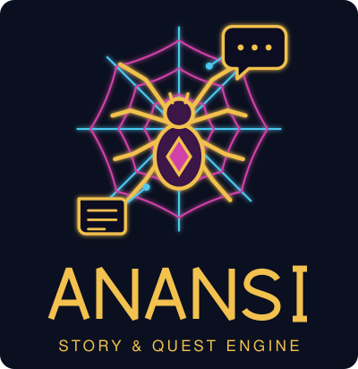

<h1 align="center">
  <picture>
    <source media="(prefers-color-scheme: light)" srcset="assets/logo/anansi-logo-light.svg">
    
  </picture>
</h1>

<p align="center"><b>One endpoint for living game worlds: NPC dialogue, quests and storylines, powered by idle GPUs.</b></p>

<p align="center">
  <a href="https://github.com/avielbaum/anansi/actions/workflows/ci.yml"></a>
  
  
</p>

<p align="center">
  <a href="docs/quickstart.md"><b>Quick start</b></a> ·
  <a href="docs/gateway.md"><b>Gateway</b></a> ·
  <a href="docs/nodes.md"><b>Nodes</b></a> ·
  <a href="docs/sdk.md"><b>SDKs</b></a> ·
  <a href="docs/status.md"><b>Status</b></a> ·
  <a href="DESIGN.md"><b>Design</b></a>
</p>

**Generative game content without the token bill.** Anansi is an "LLM@home" service that works with any game platform. A game calls one
OpenAI-compatible gateway; behind it sits a pool of small language models running on a paid cloud floor and,
later, on the idle GPUs of players who volunteer, in the spirit of Folding@home. The gateway is built for games:
dialogue, quests and storylines built only from the characters, places and items your game supplies, whitelisted NPC actions the model cannot get wrong, per-player daily budgets, sentence-by-sentence streaming,
output filtering and a local fallback so the game always gets an answer.

```
$ curl -s localhost:8080/v1/npc -H "X-Anansi-Title: demo" -H "X-Anansi-Key: change-me" \
       -H "X-Player-Token: dev:player-1" \
       -d '{"messages":[{"role":"user","content":"Could I have a discount? I am buying five potions."}],
            "npc_id":"shopkeeper","structured":true}'
{"say":"Five potions? Fine, I can knock a little off.","action":"give_discount","filtered":false,"node":"http://127.0.0.1:11434"}
```

<sub>Illustrative output: the wording varies by model, and a 1.7B model picks the right action about 3 times in 4 on 106 held-out test cases.</sub>

`action` is always one of the actions your game allows (or `none`): the model's output is constrained to that list,
and the gateway checks it again before the reply leaves.

## Why Anansi

In the folklore of the Akan people of Ghana, Anansi is the spider, a trickster and the keeper of stories and wisdom.
The tale goes that all the stories once belonged to Nyame, the sky god. Anansi, small and without any strength to
speak of, won them by cleverness, by completing tasks that seemed impossible, and carried them down to people.

This project borrows the shape of that myth:

- **Stories are the product.** Dialogue, quests and storylines for game worlds, generated on demand.
- **Cleverness over strength.** Instead of one giant, expensive model, many small models do the work, on hardware that
  is otherwise idle.
- **The web.** A spider's web is many threads that hold together even when one breaks. Anansi's mesh of cloud and
  volunteer nodes is built the same way: nodes come and go, the scheduler routes around the ones that fail, and
  the game sees one thread, a single endpoint.

## How it works

```
 game (Unity / Unreal / Godot / any HTTP client)
        |  one request: messages, npc_id, structured
        v
 +------------------------ gateway -----------------------+
 | auth (title key + player token) -> daily budget         |
 | -> system prefix, field whitelist, constrained actions  |
 | -> scheduler: affinity, power-of-two, failover          |
 | -> output filter, leak guard, optional safety judge     |
 +---------+------------------+----------------------+-----+
           |                  |                      |
      cloud floor        volunteer PC            volunteer Mac
      (vLLM, Ollama)     (node/agent.py,         (node/agent.py,
                          connects OUT)           Ollama on Metal)
```

Volunteer machines never open a port: the agent connects out to the gateway and polls for work, so it runs behind
home routers. A new node must answer a known-answer probe before it receives real traffic, and live nodes are
spot-checked afterwards.

## What works today

Measured on one Windows PC (Qwen3 through Ollama on the CPU), on a rented Linux VM with an NVIDIA A10 GPU, and live against
Ollama Cloud and OpenRouter. See
[docs/status.md](docs/status.md) for numbers and caveats.

| | |
|---|---|
| Gateway: auth, budgets, constrained actions, filter, leak guard, failover, streaming | working, 78 self-checks |
| Quest and storyline generation (`/v1/quest`, `/v1/storyline`) with Python and C# SDK methods | working: constrained to your game's own ids; 6 of 6 structurally valid with Qwen3-1.7B (33 s) and Qwen3-4B (65 s, more varied rewards and richer text) on CPU; writing quality unrated |
| Real model end to end (Ollama on CPU; vLLM and llama-server on GPU) | working: replies in 0.07 to 0.2 s on the A10, 2 to 5 s on CPU; action accuracy 76% on 106 held-out self-written cases (G1 set; **G1 not passed**: needs blind rating against a large model) |
| Safety judge (second model call) | working with Qwen3-4B: blocked 3 of 8 leak attacks, no false positives; doubles latency |
| Volunteer node agent, entry probe, spot checks, bans; one-step `join` setup | working on Windows and on the Linux GPU VM (`join.sh` with Ollama); pauses while the owner is busy, even under steady traffic (CPU and GPU; Linux Intel GPUs not measured) |
| Layered output safety: overlap guard, Llama Guard classifier, judge model | working; on 23 self-written pairs the combination caught all violations with no false positives, about 7.5 s extra on CPU |
| Python and C# SDKs with sentence streaming and local fallback | working (C# as plain .NET; Unity untested) |
| JavaScript / TypeScript SDK (browsers, Node, Electron, Deno, Bun) | working: 18 checks against a live gateway in CI; for browsers on another origin list them in `cors_origins` |
| Red-team set for gate G5 (759 prompts, dev/test split, runner) | built; untuned holdout run (420 fresh cases): 32 automatic failures; a second untuned set: 6 (5 arguable); **G5 not passed** |
| Godot 4 addon (GDScript) | working: 18 checks in the real Godot 4.3 engine against a live gateway in CI, in the editor and in an exported Linux release build (not tried on other export targets or consoles) |
| Unreal Engine 5 plugin (C++, Blueprint-callable) | **written, never compiled or run: no Unreal install was available** |
| Linux | working: gateway and SDKs in CI on Ubuntu; Docker compose (vLLM + gateway), the systemd unit, llama-server and `join.sh` run on Ubuntu 22.04 with an NVIDIA A10 |
| macOS Apple Silicon | gateway and agent self-checks (78) and the hardware readers pass on a Mac mini (Apple M6, 16 GB, macOS 27); Ollama, a real model and the SDKs not yet run there |
| GPU nodes (vLLM, llama-server) | working on an NVIDIA A10 with Qwen3-1.7B: vLLM about 165 requests/s at 32 in flight (p99 0.3 s), llama-server 0.07 s per reply; AMD and Intel GPUs untested |
| **Live platform identity check** (Steam is the only one written) | **not tested, needs a Steam publisher key** |
| Persistence (budgets, bans) and a volunteer work ledger in SQLite, or Postgres for gateways on several machines | working, tested across a restart and on Postgres 16 |
| Anonymous volunteer-network statistics (opt-in): hardware (graphics card, processor, system), tokens served and typical idle GPU load by group, a web page, JSON and SDK calls; no names, and nothing published until enough machines report | working on a real Windows PC with a real agent and gateway; Python, C#, JavaScript and Godot SDK calls; AMD and macOS hardware readers tested on sample output only |
| Volunteer credits: link a machine to a player, earn per token, 7-day hold, games spend them on their own items | working in tests (SQLite and Postgres); the Python, C#, JavaScript and Godot SDKs show the balance and link machines; Steam Inventory not connected |
| Model signing, per-user node identity, answer quorum | not built |

## Quick start

Needs Python 3.10 or newer. For a real model, install [Ollama](https://ollama.com) as well.

```bash
git clone https://github.com/avielbaum/anansi
cd anansi
pip install -r requirements.txt
python tests/test_gateway.py          # 78 self-checks, no GPU or network needed
```

Run the gateway against a local model:

```bash
ollama pull qwen3:1.7b
ollama pull qwen3:4b-instruct    # confirms each action the NPC picks; without it no action is ever taken
ANANSI_CONFIG=config.ollama.json python -m uvicorn gateway.app:make_app --factory --port 8080
python tools/eval.py --key change-me --cases evals/g1_shopkeeper.jsonl --split test     # in a second terminal
```

No model installed? Use the mock nodes: [docs/quickstart.md](docs/quickstart.md).

## Documentation

| | |
|---|---|
| [Quick start](docs/quickstart.md) | Mock nodes, Ollama, Linux, macOS, running the tests |
| [Gateway](docs/gateway.md) | Config reference, endpoints, streaming, filter, leak guard, safety judge, production switches |
| [Nodes](docs/nodes.md) | Cloud nodes, volunteer agent, verification, Linux and macOS notes |
| [Privacy](docs/privacy.md) | What is collected, shown and kept; volunteers see what players write; what to tell players (draft for counsel) |
| [Volunteer terms](docs/volunteer-terms.md) | What a volunteer agrees to (draft for counsel) |
| [SDKs](docs/sdk.md) | Python, C# (Unity), JavaScript/TypeScript, Unreal and Godot clients and their fallback behaviour, plus an MCP server for your AI assistant |
| [Status](docs/status.md) | Measured results, known limits, what is untested |
| [DESIGN.md](DESIGN.md) | Architecture, security model, roadmap and go/no-go gates |

## Repository layout

| Path | What |
|---|---|
| `gateway/` | The gateway (`app.py`), node scheduler (`scheduler.py`), pull-node hub (`pull.py`) |
| `node/agent.py` | Volunteer node agent |
| `sdk/` | Python client; C# client for Unity and .NET, with a cross-platform CI test; JavaScript/TypeScript client (`sdk/js`); Unreal plugin (`sdk/unreal`); Godot addon (`sdk/godot`) |
| `tools/` | Mock node, load test, action-accuracy eval, blind-rating sheets for gate G1, prompt-leak eval |
| `examples/` | Example games, one folder each, built on the SDKs; see [examples/README.md](examples/README.md) |
| `evals/` | Labelled test prompts |
| `tests/` | Self-checks |
| `deploy/`, `config.*.json` | Dockerfile, compose file, systemd unit, example configs |

## Licence

Different parts of the repository use different licences; [LICENSING.md](LICENSING.md) has the full table.

- **SDKs, tools, docs and examples:** MIT or Apache-2.0, your choice. Ship the SDKs in any game, free or paid,
  open or closed.
- **The core service** (`gateway/`, `node/` and the deployment files): [PolyForm Noncommercial 1.0.0](LICENSE). Free for
  personal use, research, study, hobby projects and other noncommercial purposes. **Running it commercially, for
  example as a paid service or as the backend of a monetised game, needs a separate commercial licence from the
  licensor.** This part is source-available, not open source by the OSI definition.
- **Art in `examples/`:** its own licence, given in each example's `assets/LICENSE.md` (Waypoint: CC-BY-SA 3.0 and CC0, see [its licence file](examples/waypoint/assets/LICENSE.md)).
