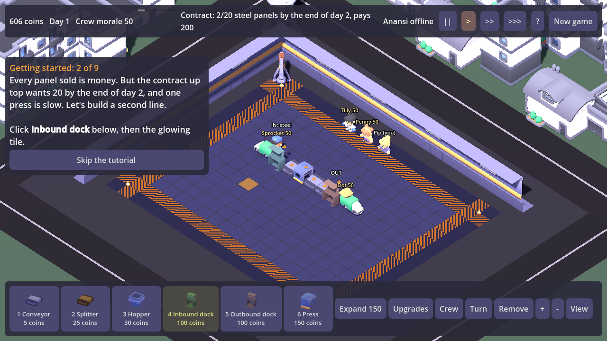

# Hoppertunity

A 3D factory tycoon for the browser: Godot 4.3, the Compatibility renderer (WebGL 2), Kenney's CC0 art, and a crew of
coworkers who talk, hand out quests and tell their stories through Anansi (`sdk/godot`). You are Pip Hopper, the new
floor manager of the Hopper Works, a small gadget plant on its last chance.



## The game

- **Build a line:** inbound docks order raw materials, conveyors and splitters move them, hoppers buffer them, presses,
  molders, assemblers and packers turn them into goods, and outbound docks sell them. Belts back up, docks stop
  ordering when there is nowhere to unload, and you pay only for crates that arrive.
- **Contracts:** ship a set number of one product before the deadline for a bonus. Each finished contract unlocks the
  next machine and material; five finished contracts save the plant. A missed deadline costs a penalty.
- **Days:** a day is one minute at normal speed. At the end you pay wages and rent and see the day's numbers. Fall 500
  coins into debt and the Works closes. Each machine also costs 5 coins a day to keep running.
- **Tutorial:** eight steps walk a new manager from the first dock to the first errand, pulsing the button to press.
  It can be skipped, and a saved game remembers where you were.
- **Trouble shows:** a machine that is jammed, blocked or short of an input says so above it.
- **The crew:** Dot (docks), Sprocket (machines), Tilly (packing and quality) and Penny (sales) each have a morale from
  0 to 100. Morale scales their station from 0.8x to 1.2x: truck turnaround, machine speed and jams, defective units
  that come back unpaid, and selling prices. Everyone loses 3 morale on an ordinary day, so a crew left alone sours.
  Below 30 on average the crew walks out for a day; above 70 everything sells for 10% more.

## What Anansi does

The model picks words and one whitelisted action. The game owns every number (`src/sim.gd`), so nothing a model says
can do more than the table below.

| Call | When | Effect in the game |
|---|---|---|
| `chat` (structured) | You type to a coworker | `morale_up` / `morale_down`: 5 morale, at most 10 a day per coworker. `offer_quest`: starts their quest. `share_tip`: reveals the next contract. `ask_raise`: asks you for a raise (you decide: +5 wage a day and +15 morale, or -10 morale). |
| `quest` | Generated ahead of time, one per coworker | Steps are `talk_to` a coworker, `inspect` a station or `deliver` goods, built only from what your plant has unlocked. The reward tier pays 60, 140 or 280 coins and lifts the giver's morale. |
| `storyline` | Once per coworker at the start of a game | Four beats, told one at a time as you finish that coworker's quests. The last beat gives a permanent perk (no more jams, no more defects, faster docks, better prices). |

Each coworker is sent who they are, their morale, the day, the cash and the contract, so what they say fits the plant.
**Without a gateway the game plays the same:** written lines by mood, eight written quests and four written stories
(`src/data.gd`). The Any work? and Offer a raise buttons work either way. The top bar shows whether the last answer
was live.

## Run it

You need [Godot 4.3](https://godotengine.org/download/archive/4.3-stable/) (the version CI uses).

```
godot --path examples/hoppertunity                    # play on the desktop
```

In the browser (install the 4.3 web export template in the editor first: Editor > Manage Export Templates):

```
godot --headless --path examples/hoppertunity --export-release Web build/web/index.html
python -m http.server 8000 --directory examples/hoppertunity/build/web
```

Then open http://localhost:8000. The export is single-threaded, so any static server works.

For live coworkers, run a local gateway with this example's title (it expects Ollama with `qwen3:1.7b` on port 11434;
edit `nodes` in the config for another model server):

```
ANANSI_CONFIG=examples/hoppertunity/config.hoppertunity.json python -m uvicorn gateway.app:make_app --factory --port 8080
```

The game talks to `http://127.0.0.1:8080` (`GATEWAY` in `src/main.gd`), and the config allows the page origins
`http://localhost:8000` and `http://127.0.0.1:8000`. This is a local demo: it uses `dev` auth and ships the example
title key, so do not put it on the public internet as it is (see `docs/sdk.md`, Browsers).

## Controls

Click a build button, then the floor. **R** turns the piece (or the building under the mouse), right-click cancels
the tool or removes a building for half its price. Drag to lay conveyor. Click a coworker to talk, a building to
inspect it, an inbound dock to change what it orders. **WASD** or the arrows move the view, **Q**/**E** turn it, the
wheel zooms, **Space** pauses, **M** mutes.

## Code

| File | What it holds |
|---|---|
| `src/data.gd` | Every number and every written word: items, machines, contracts, the crew, fallback lines, quests, stories |
| `src/sim.gd` | The whole game as plain data on a fixed tick: no nodes, so it runs headless and saves as one dictionary |
| `src/crew.gd` | Every Anansi call, and what each answer may do to the sim |
| `src/main.gd` | The 3D view, input, interface, tutorial and sound, all built in code |
| `addons/anansi` | A copy of `sdk/godot/addons/anansi`; CI fails if the two differ |
| `test/checks.gd` | Self-checks: `godot --headless --path examples/hoppertunity --script res://test/run.gd` |

CI (`.github/workflows/ci.yml`, job `godot`) runs the self-checks against a gateway serving this title on mock nodes,
and exports the web build. The checks include two scripted playthroughs of one production line: a manager who gives a
raise whenever someone's morale sags wins on day 9 without going into debt; one who ignores the crew gets four walkouts,
misses three deadlines and has not won by day 20. A full 28x24 floor of moving belts ticks in under 5 ms on a laptop.

## Not done yet

- Coworkers that walk the floor (they stand along the back wall; Pip walks to whatever you click, in a straight
  line), forklifts, music.
- The sound effects (Kenney, CC0) were wired up on a machine with no audio device: nobody has listened to the mix yet.
- The browser build was run by hand in Chrome on a 2013 laptop GPU (Quadro K1100M), without a gateway and with one
  (Ollama, `qwen3:1.7b` on CPU: a first reply took 30 s, so the chat timeout is 45 s). It held 55 frames a second for
  a new game and for the largest floor with every tile a moving conveyor (`?stress` in the address, or `-- stress` on
  the desktop; **F3** shows the frame rate). CI checks that the web build exports, not that it runs.
- A few hundred `Label3D` nodes make the browser build draw no 3D at all (672 labelled buildings: blank; the same
  672 without labels: fine; the desktop build never minded). So building tags are painted on one 2D overlay, and
  conveyors and arrows are drawn in four batches. With that, 672 hoppers (`?stress&fill=hopper`) also hold 55 frames a
  second. The crew's name tags and the "+8" sale pop-ups are still `Label3D`, a handful at a time.
- Replies arrive whole (`chat`), not sentence by sentence: a streamed reply carries no action, and the game needs
  the action. The SDK itself does stream in a browser: `sdk/godot`'s 18 checks, exported for the web from a scratch
  copy, all passed in Chrome against a gateway on mock nodes (run by hand, not in CI; whether sentences arrive one at a
  time or all together was not measured).
